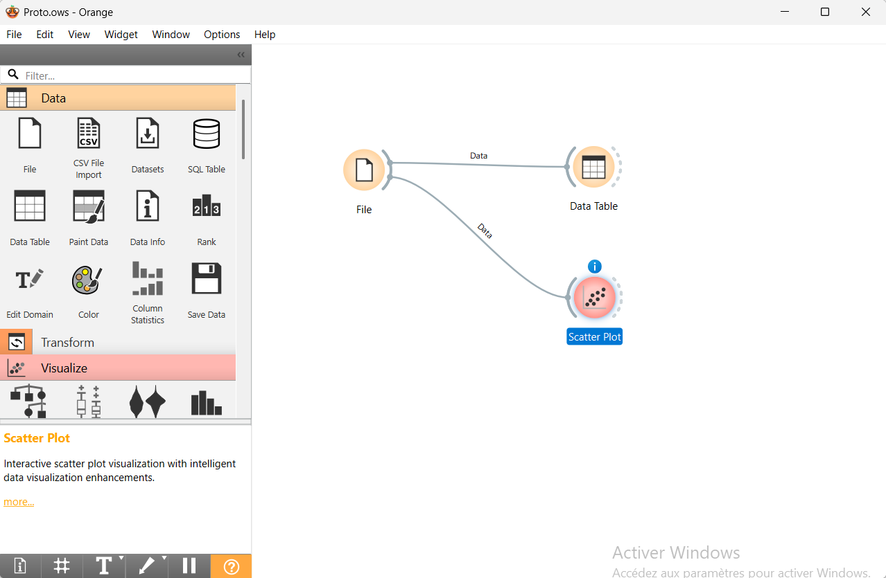
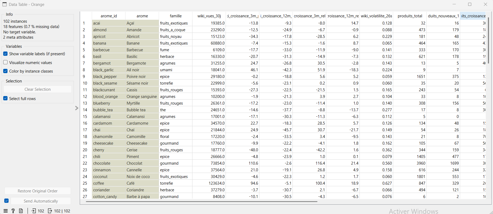
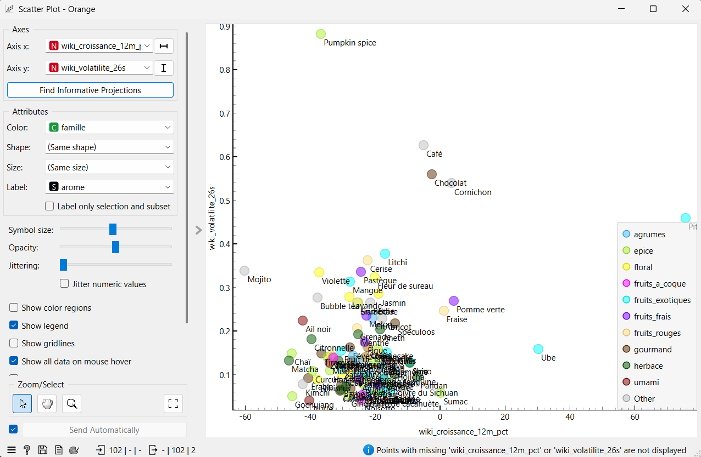

# Livrable final · Équipe Data · Matcha Data

**Hackathon HETIC × Givaudan 2026 · Équipe Data**

> **Question métier :** quand un arôme monte, est-ce une **tendance durable** (à proposer en R&D) ou un **buzz passager** (à ne pas engager) ?

**Notre réponse :**
- une pipeline qui collecte chaque nuit **7 sources publiques réelles** sur **102 arômes** ;
- deux modèles « buzz ou durable » (**V1** règle simple, **V2** régression logistique), validés sur **82 cas réels** ;
- une **API FastAPI** intégrée au prototype Tech ;
- une couche **IA locale (Ollama)** qui explique chaque arôme en langage simple.

> **Résultats clés**
> - **102 arômes suivis**, chacun couvert par **au moins 3 sources réelles indépendantes**, avec ≈ 271 000 lignes propres mises à jour chaque nuit.
> - **Modèle V2 : 82 % de bonnes réponses** sur 82 hausses passées réelles, **2 fois moins de fausses alertes** que la règle simple V1, et **6 critères sur 6** remplis.
> - **Valeur pour Givaudan** : repérer un buzz avant d'investir (le curry aujourd'hui : 13 % de chances de durer) et confirmer les arômes installés (le matcha : 138 produits, 85 marques, 37 pays).
> - **Intégré au prototype** : API de 10 routes, et une explication en langage simple pour chacun des 102 arômes.

| | |
|---|---|
| API (Swagger) | https://word-anyone-retract.ngrok-free.dev/docs *(en ligne quand le PC Data est allumé ; sinon voir [Reproduire](#6-reproduire-les-résultats))* |
| Contrat d'interface | [`api/openapi.json`](api/openapi.json) (OpenAPI v1.2.0, 10 routes), aussi servi en direct par l'API sur `/openapi.json` |
| Code | [`src/flavortrends/`](src/flavortrends/) · tests : [`tests/`](tests/) (97 tests) |

---

## Sommaire
1. [Livrables jour par jour](#1-livrables-jour-par-jour)
2. [Données](#2-données)
3. [Modèles V1 / V2 et validation](#3-modèles-v1--v2-et-validation)
4. [API et intégration au prototype](#4-api-et-intégration-au-prototype)
5. [IA locale : AI Trend Analyst](#5-ia-locale--ai-trend-analyst)
6. [Reproduire les résultats](#6-reproduire-les-résultats)
7. [Limites et biais](#7-limites-et-biais)
8. [Résultats Data dans la démonstration finale](#8-résultats-data-dans-la-démonstration-finale)
9. [Structure du dépôt](#9-structure-du-dépôt)

---

## 1. Livrables jour par jour

Légende : ✅ fait et vérifiable dans ce dépôt ou dans l'API

### Lundi 9 · Exploration

| Livrable attendu | Statut | Où |
|---|---|---|
| 1. Inventaire des sources et modalités d'accès | ✅ | [§2 Données](#2-données) (sources, mode d'accès, volumes) · [`src/flavortrends/collectors/`](src/flavortrends/collectors/) (un collecteur par source) |
| 2. Premier échantillon récupéré | ✅ | Base Supabase (schémas `raw` et `core`) · [`data/sample/`](data/sample/) |
| 3. Analyse initiale de la qualité | ✅ | [§2](#2-données) et [§7](#7-limites-et-biais) · commande `flavortrends status` (volumes, doublons, sponsorisé, erreurs par source) |
| 4. Solution alternative si données indisponibles | ✅ | Reddit, TikTok et X → Bluesky + YouTube ; API Google Trends fermée → `pytrends` + import manuel ; GDELT bloqué → Google News + RSS ; API Pinterest réservée aux partenaires → exports manuels |

### Mardi 10 · Gate 1

| Livrable attendu | Statut | Où |
|---|---|---|
| 1. Dataset exploitable | ✅ | [`data/sample/reference_cases.csv`](data/sample/reference_cases.csv) (en-têtes au format Orange) · exports Orange : `flavortrends export-orange` · exploration dans Orange : [captures](#exploration-dans-orange-data-mining) |
| 2. Premier résultat représentatif (V1) | ✅ | **V1 = règle « gros pic = buzz »** : 74 % des buzz détectés ([§3](#3-modèles-v1--v2-et-validation)) |
| 3. Preuve de faisabilité (script) | ✅ | [`src/flavortrends/spike2.py`](src/flavortrends/spike2.py), commande `flavortrends spike2-build` · validation reproduite dans Orange ([§3](#3-modèles-v1--v2-et-validation)) |
| 4. Swagger / OpenAPI | ✅ | Contrat statique [`api/openapi.json`](api/openapi.json) · Swagger interactif `/docs` sur l'API · [`src/flavortrends/api.py`](src/flavortrends/api.py) |
| 5. Endpoint accessible à Tech via ngrok | ✅ | L'API renvoyait déjà de **vraies données** au lieu d'un endpoint factice |

### Jeudi 12 · Prototype

| Livrable attendu | Statut | Où |
|---|---|---|
| 1. Données nettoyées et préparées | ✅ | Schéma `core` (Supabase) · [§2](#2-données) |
| 2. Pipeline de traitement fonctionnel | ✅ | `flavortrends run` (collecte → nettoyage → recalcul), automatique chaque nuit à 3 h et toutes les 4 h pour la presse |
| 3. Modèle V2 publié | ✅ | [`data/sample/model_v2.json`](data/sample/model_v2.json) · `GET /api/v1/model-metrics` · `POST /api/v1/simulate` |
| 4. Métriques et protocole de validation sur ≥ 30 cas | ✅ | **82 cas** · [§3](#3-modèles-v1--v2-et-validation) · [`data/sample/model_metrics.json`](data/sample/model_metrics.json) |
| 5. API fonctionnelle renvoyant les résultats réels | ✅ | [§4](#4-api-et-intégration-au-prototype) |
| Modèle intégré au prototype Tech | ✅ | Le prototype Tech appelle l'API Data (via ngrok) pour afficher arômes, statuts et résultats du modèle |

### Vendredi 13 · Finalisation

| Livrable attendu | Statut | Où |
|---|---|---|
| 1. Code et documentation finalisés | ✅ | Ce README · code commenté dans [`src/flavortrends/`](src/flavortrends/) · 97 tests automatiques |
| 2. Procédure de reproduction | ✅ | [§6](#6-reproduire-les-résultats) |
| 3. Comparaison V1 / V2 avec métriques | ✅ | [§3](#3-modèles-v1--v2-et-validation) |
| 4. Analyse des limites et des biais | ✅ | [§7](#7-limites-et-biais) |
| 5. Résultats Data intégrés à la démonstration | ✅ | [§8](#8-résultats-data-dans-la-démonstration-finale) : ce que le prototype affiche et scénario de démonstration |

---

## 2. Données

**Périmètre :**
- **102 arômes** (fruits, épices, gourmands, floraux, umami…), définis dans [`taxonomy/flavors.csv`](taxonomy/flavors.csv) avec leurs synonymes en français et en anglais ;
- **tous les aliments, monde entier**.

| Source | Ce qu'elle mesure | Lignes propres (12/11) | Accès |
|---|---|---|---|
| Google Trends | Intérêt de recherche (monde et France), 5 ans d'historique | 30 049 | `pytrends` (non officiel), automatique |
| Wikipédia | Vues des pages d'arômes | 207 155 | API officielle |
| Open Food Facts | Produits en rayon qui citent l'arôme (marques, pays, catégories) | 20 985 | Export officiel + mises à jour quotidiennes |
| Google News | Articles de presse | 2 192 | Flux RSS |
| 11 flux RSS spécialisés | Presse agroalimentaire | 290 | RSS |
| Bluesky | Posts publics | 10 242 | API officielle (mot de passe d'application) |
| YouTube | Vidéos | 197 | API officielle (quota) |
| Pinterest | Tendances de recherche | exports manuels | API réservée aux partenaires |

### Qualité mesurée

**Couverture des 102 arômes par source** (données du 12/11) :

| Source | Arômes couverts | Part |
|---|---|---|
| Open Food Facts (au moins 1 produit en rayon) | 102 / 102 | 100 % |
| Wikipédia (vues sur 30 jours) | 102 / 102 | 100 % |
| Réseaux sociaux (au moins 1 mention sur 30 jours) | 102 / 102 | 100 % |
| Google Trends monde (courbe d'au moins un an) | 95 / 102 | 93 % |
| Presse (au moins 1 article sur 30 jours) | 92 / 102 | 90 % |
| Google Trends exploitable (volume suffisant pour mesurer une évolution) | 70 / 102 | 69 % |
| YouTube (vues sur 30 jours) | 70 / 102 | 69 % |

→ **Chaque arôme est couvert par au moins 3 sources indépendantes**, et 95 arômes ont des preuves récentes (titres d'articles ou de vidéos).

**Ce que le nettoyage a écarté** :

| Source | Lignes brutes | Lignes propres | Doublons repérés | Contenus sponsorisés repérés |
|---|---|---|---|---|
| Google News | 2 260 | 2 192 | 129 (5,9 %) | 1 |
| Bluesky | 11 222 | 10 242 | 236 (2,3 %) | 41 (0,4 %) |
| YouTube | 197 | 197 | 6 (3,0 %) | 17 (8,6 %) |
| Flux RSS | 291 | 290 | 0 | 0 |

Les **doublons sont exclus** des indicateurs. Les **contenus sponsorisés sont mesurés à part** (indicateur « part sponsorisée » de chaque arôme), ce qui permet de repérer un buzz payé. Les lignes inutilisables sont écartées avec leur raison.

**Nettoyage** ([`src/flavortrends/cleaning/`](src/flavortrends/cleaning/)) :
- HTML retiré, Unicode normalisé, dates en UTC ;
- langue déclarée ou détectée ;
- auteurs **pseudonymisés** (HMAC-SHA256, RGPD) ;
- contenus sponsorisés repérés ;
- doublons exacts (empreinte sha256) et **quasi-doublons** (MinHash + LSH, seuil 0,8) écartés, chaque fois avec leur raison.

**Stockage** ([`migrations/`](migrations/)) :
- Supabase (PostgreSQL), environ 200 Mo sur 500 ;
- schéma `raw` pour la réponse brute, versionnée ;
- schéma `core` pour les données propres.

**Rattachement aux 102 arômes :**
- recherche en mot entier, sans accents, sur le nom et les synonymes de chaque arôme ;
- chaque arôme est associé à **un ou plusieurs des 14 types de produits** du prototype (boissons, glaces, chocolats…), calculés sur les catégories des vrais produits Open Food Facts. Un type est retenu à partir de 10 % des produits ([`src/flavortrends/product_types.py`](src/flavortrends/product_types.py)).

### Exploration dans Orange Data Mining

Les indicateurs des 102 arômes sont exportés au format Orange (`flavortrends export-orange`) et explorés dans l'outil :

| Workflow | Tableau des 102 arômes |
|---|---|
|  |  |



**Ce que montre l'exploration** (chaque point est un arôme, coloré par famille) :
- **94 arômes sur 100 ont des vues Wikipédia en baisse sur un an** : c'est une baisse générale de Wikipédia, pas des arômes. C'est pour ça que le projet mesure la croissance **relative** entre arômes.
- **Deux arômes se détachent nettement en croissance** : le **pitaya** (+76 %) et l'**ube** (+30 %), à surveiller.
- **Quatre arômes ont une courbe très irrégulière** (irrégularité au-dessus de 0,5) : **pumpkin spice** (0,88), **café**, **chocolat** et **cornichon**. Pour le pumpkin spice, c'est un profil typiquement saisonnier, ce qui confirme qu'il faut séparer saisonnalité et tendance, comme le fait la règle « +20 % par rapport à l'an dernier ».

---

## 3. Modèles V1 / V2 et validation

### Jeu de référence (82 cas réels)

**Un cas** = un arôme en **vraie hausse** à une date T0, c'est-à-dire :
- au moins **+20 % sur 13 semaines** ;
- **et** au moins **+20 % par rapport à l'an dernier**, pour écarter les hausses simplement saisonnières.

**Étiquette** (la bonne réponse) : on regarde **un an plus tard**, entre les semaines +39 et +52.
- **« durable »** si l'arôme a gardé au moins **50 % de son gain** ;
- **« buzz »** sinon.

**Contenu** : 82 cas, 25 arômes, monde et France, de 2023 à 2025, soit 63 durables et 19 buzz. Fichier : [`data/sample/reference_cases.csv`](data/sample/reference_cases.csv), avec pour chaque cas les variables, le verdict V1, le verdict V2 et la vraie réponse.

### Modèles

- **V1 (Gate 1)** : règle simple, « buzz » si le pic récent dépasse 1,5 fois la moyenne sur 26 semaines.
- **V2 (prototype)** : régression logistique sur la **forme de la courbe** (intensité du pic, irrégularité, accélération, croissance sur 13 semaines).

### Protocole et critères de validation

- **Validation « leave-one-flavor-out »** : chaque arôme est prédit par un modèle qui **ne l'a jamais vu**.
- **Comparaison** avec une référence naïve, « toujours durable ».
- **Critères** définis avec l'équipe Product :

| # | Critère | Pourquoi pour Givaudan | Seuil | V1 | **V2** |
|---|---|---|---|---|---|
| C1 | Buzz détectés | Ne pas engager de R&D sur un buzz | ≥ 60 % | 74 % ✅ | **68 %** ✅ |
| C2 | Fausses alertes | Ne pas rater de vraies tendances | ≤ 20 % | 27 % ❌ | **14 %** ✅ |
| C3 | Précision quand le verdict est « buzz » | Crédibilité de l'alerte | ≥ 50 % | 45 % ❌ | **59 %** ✅ |
| C4 | Mieux que « tout est durable » | Prouver la valeur ajoutée | Accuracy équilibrée > 50 % | 73 % ✅ | **77 %** ✅ |
| C5 | Testé sur des arômes jamais vus | Éviter un modèle qui apprend par cœur | Obligatoire | ✅ | ✅ |
| C6 | Explicable | L'utilisateur comprend le verdict | Chiffres et preuves fournis | ✅ | ✅ |

### Résultats

| | Référence « toujours durable » | **V1** (règle) | **V2** (modèle retenu) |
|---|---|---|---|
| Bonnes réponses (accuracy) | 77 % | 73 % | **82 %** |
| Accuracy équilibrée | 50 % | 73 % | **77 %** |
| Buzz détectés (rappel buzz) | 0 % | 74 % | **68 %** |
| Fausses alertes (durables classés buzz) | 0 % | 27 % | **14 %** |
| Précision quand le verdict est « buzz » | — | 45 % | **59 %** |
| ROC AUC | — | — | **0,81** |

**Matrice de confusion V2** (82 cas) :

| | Prédit durable | Prédit buzz |
|---|---|---|
| **Vraiment durable** | 54 | 9 |
| **Vraiment buzz** | 6 | 13 |

**Lecture :**
- La référence naïve a une bonne accuracy, mais ne détecte **aucun** buzz : c'est pour ça qu'on regarde l'accuracy équilibrée et les buzz détectés.
- V2 détecte presque autant de buzz que V1, avec **deux fois moins de fausses alertes**.
- **V2 satisfait les 6 critères, V1 seulement 4.**

**Exemples réels :** sur les 82 cas, **V2 se trompe 15 fois, contre 22 pour V1**.

| Cas | V1 | V2 (probabilité « durable ») | Réalité un an après | Lecture |
|---|---|---|---|---|
| Matcha, France, janvier 2024 | buzz ❌ | durable ✅ (68 %) | durable | V2 corrige une fausse alerte de V1 |
| Bubble tea, monde, mars 2023 | buzz ✅ | buzz ✅ (2 %) | buzz | Buzz détecté avec une forte certitude |
| Matcha, monde, juillet 2025 | durable ✅ | durable ✅ (85 %) | durable | Tendance durable reconnue |
| Yuzu, France, mai 2023 | buzz ✅ | durable ❌ (62 %) | buzz | Cas limite : V2 hésitait (62 %). Un mois plus tard (juin 2023), V2 passe à 21 % et le classe bien « buzz » ✅ |

La probabilité indique la confiance du modèle : près de 0 % ou de 100 %, le verdict est net ; autour de 50 %, il est incertain et l'arôme est à surveiller. C'est pourquoi l'API affiche un statut « issue incertaine » entre 40 % et 60 %.

**Aujourd'hui :** seul le **curry** est en vraie hausse (pic de 3,8 fois la moyenne). V2 lui donne 13/100 de chances de durer, donc un buzz probable.

**Reproduire dans Orange Data Mining :**
```
File (reference_cases.csv)
  → Select Columns (Features : croissance_13s, volatilite_26s, pic_ratio, acceleration)
  → Test and Score (Leave one out) ← Logistic Regression
  → Confusion Matrix
```
Orange valide « un cas à la fois » et non « un arôme à la fois » : les chiffres sont proches, sans être identiques.

---

## 4. API et intégration au prototype

FastAPI, dans [`src/flavortrends/api.py`](src/flavortrends/api.py). Le Swagger (`/docs`) documente les schémas de chaque réponse et les codes d'erreur (404, 422, 503, 500, toujours en JSON `{"detail": "..."}`).

| Route | Rôle |
|---|---|
| `GET /api/v1/trends` | Les 102 arômes : statut, rayons, indicateurs, preuves. Filtres `category`, `status`, `include_series` |
| `GET /api/v1/trends/{id}` | Fiche complète d'un arôme, avec sa courbe sur 104 semaines |
| `GET /api/v1/product-types` | Les 14 rayons du supermarché 3D et leur nombre d'arômes |
| `GET /api/v1/model-metrics` | Validation de V2, comparée à V1 |
| `POST /api/v1/simulate` | Probabilité V2 pour des variables saisies à la main |
| `GET /api/v1/ai/indicators` | Indicateurs métier des 102 arômes, sans LLM |
| `GET /api/v1/trends/{id}/insight` | Explication en langage simple (IA locale) |
| `GET /api/v1/trends/{id}/packet` | Fiche d'entrée prête pour la simulation MiroFish |
| `GET /api/v1/health`, `GET /api/v1/ai/health` | État de l'API et d'Ollama |

**Comment l'API est accessible :**
- **Prototype** : l'équipe Tech appelle l'API via **ngrok** ; le prototype affiche les arômes, leurs rayons, leurs statuts, leurs fiches et les explications IA.
- **Données** : pré-calculées chaque nuit, donc des réponses instantanées et fiables en démo.

---

## 5. IA locale : AI Trend Analyst

LLM **local** (Ollama, `qwen2.5:1.5b`, le modèle fourni en cours). Il transforme les résultats en explication métier : résumé, facteurs, opportunité, recommandation et limites ([`src/flavortrends/analyst.py`](src/flavortrends/analyst.py)).

- **Séparation stricte** : tous les chiffres et le statut sont calculés en **Python**. Le LLM ne rédige que le texte, à partir des faits déjà rédigés en français, et les chiffres sont réinjectés après sa réponse.
- **Contrôles automatiques** sur chaque réponse :
  - sortie JSON imposée par un schéma ;
  - texte en français ;
  - statut respecté ;
  - aucun chiffre absent des données ;
  - aucune consigne du prompt ni étiquette interne recopiée.

  Si un contrôle échoue, le modèle a un essai de correction, puis on utilise un **texte de repli** (l'API ne tombe jamais à cause du LLM).
- **Indicateurs** :
  - **calculés** : taux de croissance, score V2, niveau de confiance ;
  - **bêta**, présentés comme tels : statut métier (exploding / emerging / growing / seasonal / stable / declining), buzz score et trend score, qui sont des rangs relatifs entre les 102 arômes.
- **Résultat** : 69 explications sur 102 rédigées par l'IA et validées par les contrôles, 33 par le texte de repli. Elles sont mises en cache dans [`data/sample/insights/`](data/sample/insights/).

---

## 6. Reproduire les résultats

### A. Juste l'API, avec les données publiées (sans base ni clés)

Python 3.11 ou plus :
```bash
git clone https://github.com/Imranch4/Matcha-Data.git && cd Matcha-Data
python -m venv .venv && .venv/Scripts/activate        # macOS/Linux : source .venv/bin/activate
pip install -e ".[spike,dev]"
flavortrends serve                                    # http://localhost:8000/docs
```

### B. Toute la pipeline

```bash
cp .env.example .env                 # DATABASE_URL (Supabase, port 5432), clés YouTube et Bluesky, sel
flavortrends init-db                 # crée les schémas raw et core
flavortrends load-taxonomy           # charge les 102 arômes
flavortrends run                     # collecte → nettoyage → modèles V1/V2 → données de l'API
flavortrends spike2-build            # recalcule seulement les modèles et les données de l'API
flavortrends insights --all          # explications IA (Ollama + qwen2.5:1.5b)
flavortrends export-orange --out data/sample/orange   # exports pour Orange
pytest                               # 97 tests
```

Automatisation sous Windows : [`scripts/windows/install_tasks.ps1`](scripts/windows/install_tasks.ps1) installe les tâches planifiées (collecte chaque nuit à 3 h, presse toutes les 4 h, contrôle de fraîcheur à 8 h 30).

---

## 7. Limites et biais

**Comment nous les avons traités.** Chaque source et chaque modèle a ses limites. Nous les avons identifiées dès le départ et intégrées à la conception, pour que les résultats restent fiables.

### Données

| Limite ou biais | Ce que nous avons mis en place |
|---|---|
| Google Trends n'a pas d'API officielle et limite le nombre de requêtes | Collecte automatique avec `pytrends`, requêtes groupées par popularité, reprises automatiques et complément chaque nuit. **Les 102 arômes sont couverts au niveau monde** (5 ans d'historique). |
| Certains arômes de niche ont trop peu de recherches (32 sur 102) | Ils reçoivent un statut explicite **« trop peu de données »** au lieu d'un faux verdict, et restent décrits par leurs autres sources (produits en rayon, presse, Wikipédia). |
| **Biais saisonnier** : un arôme peut monter chaque été sans être une tendance | Une hausse ne compte que si elle dépasse aussi **+20 % par rapport à l'an dernier** ; sinon elle est classée « saisonnière ». |
| **Biais de source** : chaque plateforme a son public (réseaux plutôt anglophones, Wikipédia en baisse générale) | **7 sources croisées** (recherche, presse, réseaux, produits en rayon). Wikipédia est mesurée en croissance **relative** entre arômes, ce qui neutralise sa baisse globale. |
| Le pays d'un post sur les réseaux n'est pas connu | Les données par pays viennent des sources où il est fiable : Google Trends (zone), Google News (édition), Open Food Facts (pays de vente). |
| Un même mot peut avoir deux sens (« orange » couleur ou fruit) | Recherche en **mot entier**, sans accents, avec **synonymes en français et en anglais** pour chacun des 102 arômes. |
| Certaines plateformes sont fermées (Reddit, TikTok, X, Instagram, GDELT) | Remplacées par des sources ouvertes et légales : Bluesky et YouTube pour les réseaux, Google News et 11 flux RSS pour la presse. |
| Données personnelles (auteurs des posts) | Auteurs **pseudonymisés** (HMAC-SHA256) dès le nettoyage, conformément au RGPD. |

### Modèle

| Limite ou biais | Ce que nous avons mis en place |
|---|---|
| Échantillon de référence de taille moyenne (82 cas, 63 durables / 19 buzz) | **82 cas réels**, soit près de 3 fois les 30 demandés. Métriques adaptées au déséquilibre (accuracy équilibrée, buzz détectés) et comparaison avec une référence naïve. |
| Risque qu'un modèle apprenne par cœur | Validation **« leave-one-flavor-out »** : chaque arôme est prédit par un modèle qui ne l'a jamais vu. |
| Le modèle ne prédit que les arômes en vraie hausse | Les autres arômes reçoivent quand même un statut (stable, en baisse, saisonnier) et des indicateurs : **les 102 arômes sont couverts**. |
| Les résultats doivent rester à jour | Données et modèle **recalculés automatiquement chaque nuit** ; les performances sont publiées dans l'API (`/model-metrics`). |

### IA

| Limite ou biais | Ce que nous avons mis en place |
|---|---|
| Un LLM peut inventer des informations | Tous les chiffres sont calculés en Python ; le LLM ne rédige que le texte, et **chaque réponse est contrôlée** (langue, statut, chiffres présents dans les données). |
| Le LLM peut être indisponible ou lent | **Texte de repli** automatique : l'API répond toujours. Les explications sont mises en cache pour une réponse instantanée. |
| Les indicateurs « buzz score » et « trend score » sont nouveaux | Leur définition est fournie avec chaque réponse de l'API, et ils sont présentés comme des rangs relatifs entre arômes. |

### Prochaines étapes

- **Simulation MiroFish** : les 102 fiches d'entrée sont déjà prêtes (`/api/v1/trends/{id}/packet`).
- **Extraction des arômes par LLM** : distinguer l'arôme principal d'un ingrédient secondaire dans un produit.
- **Pinterest** : intégration des exports de l'outil Pinterest Trends.
- **Statut réglementaire EFSA** pour chaque arôme.

---

## 8. Résultats Data dans la démonstration finale

Le prototype Tech (supermarché 3D) affiche **directement les résultats calculés par la Data**, en appelant l'API. Aucune donnée n'est saisie à la main dans le prototype.

### Ce que voit l'utilisateur

| Écran du prototype | Résultat Data affiché | Route de l'API | Nature |
|---|---|---|---|
| **Supermarché 3D** | Les 102 arômes rangés dans leurs rayons (14 types de produits), couleur selon le statut (stable, en baisse, saisonnier, buzz…) | `GET /api/v1/trends`, `GET /api/v1/product-types` | Réelle |
| **Fiche d'un arôme** | Courbe de recherche sur 104 semaines, croissance sur 3 mois et sur un an, produits, marques et pays en rayon, bruit média sur 30 jours | `GET /api/v1/trends/{id}` | Réelle |
| **Preuves** | Titres d'articles et de vidéos récents, avec lien vers la source | `GET /api/v1/trends/{id}` (`evidence`) | Réelle |
| **Verdict « buzz ou durable »** | Probabilité V2 que la hausse dure un an, pour un arôme en vraie hausse | `GET /api/v1/trends/{id}` (`scores`) | Réelle (modèle validé) |
| **Explication en langage simple** | Résumé, facteurs, opportunité et recommandation | `GET /api/v1/trends/{id}/insight` | Texte rédigé par l'IA à partir des données réelles |
| **Fiabilité du modèle** | 82 cas de référence, V2 comparé à V1, matrice de confusion | `GET /api/v1/model-metrics` | Réelle |

### Scénario de démonstration

1. **Le supermarché** : les 102 arômes sont en rayon, colorés selon leur statut. On montre que **toute la gamme est couverte**, et que chaque arôme est rangé dans ses vrais types de produits (le matcha dans les boissons, le curry dans les plats préparés et les sauces).
2. **Le curry, le buzz du moment** : c'est le seul arôme en vraie hausse aujourd'hui, avec un pic de **3,8 fois la moyenne**. Le modèle V2 lui donne **13 % de chances de durer** : buzz probable, et l'explication IA conseille la prudence avant d'investir.
3. **Le matcha, l'arôme installé** : recherches stables, mais très présent en rayon (**138 produits, 85 marques, 37 pays**) et très visible dans les médias (buzz score de 82, plus que 82 % des arômes). C'est une valeur sûre, pas une nouvelle tendance.
4. **La preuve que le modèle fonctionne** : sur **82 hausses passées** dont on connaît la suite, V2 a raison dans **82 %** des cas. Par exemple, il a reconnu que la hausse du matcha en France début 2024 était durable, là où la règle simple V1 donnait une fausse alerte.
5. **Des données réelles et vérifiables** : on clique sur une preuve pour ouvrir l'article d'origine.

**Message clé pour Givaudan :** l'outil sépare les buzz passagers des tendances durables et explique chaque verdict avec des chiffres et des sources. Les équipes R&D savent ainsi où investir.

---

## 9. Structure du dépôt

```
src/flavortrends/
  collectors/        une classe par source (quotas, reprises, collecte incrémentale)
  cleaning/          nettoyage, langue, pseudonymisation, doublons
  spike2.py          cas de référence, modèles V1/V2, données de l'API
  product_types.py   rattachement aux 14 types de produits
  analyst.py         IA locale (Ollama) : indicateurs + explications
  api.py             API FastAPI
  cli.py             commande « flavortrends »
migrations/          schémas SQL (raw, core)
taxonomy/            les 102 arômes et leurs synonymes
data/sample/         données publiées : reference_cases.csv, model_v2.json, model_metrics.json,
                     trends_scored.json, insights/, mirofish_packets/
scripts/windows/     tâches planifiées (collecte automatique)
tests/               97 tests automatiques
api/openapi.json     contrat d'interface de l'API (OpenAPI 1.2.0)
captures/            captures de l'exploration dans Orange Data Mining
```
